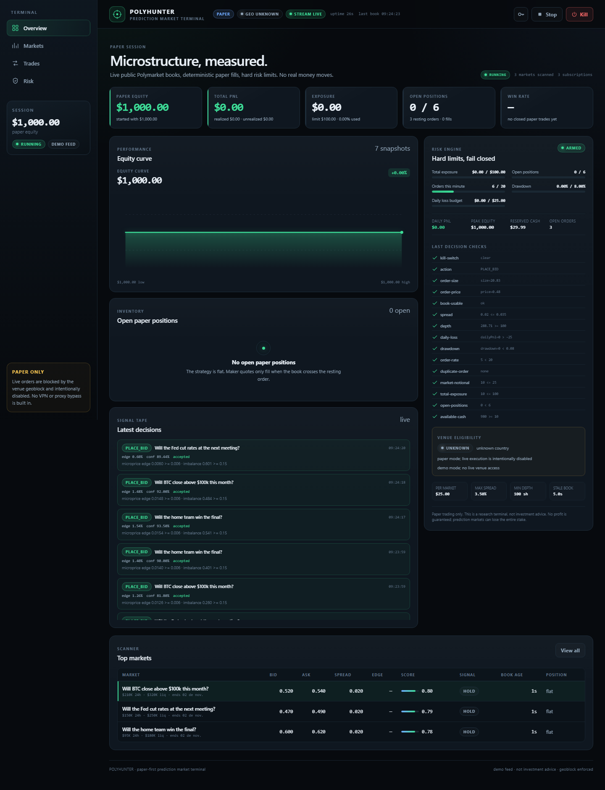

# PolyHunter

Paper-first Polymarket microstructure terminal: live public order books, deterministic paper fills,
hard risk controls, replay/backtest and a realtime dashboard.

[](https://github.com/KayzenRoot/polumarket-hunter/actions/workflows/ci.yml)
[](https://github.com/KayzenRoot/polumarket-hunter/actions/workflows/security.yml)
[](https://github.com/KayzenRoot/polumarket-hunter/actions/workflows/codeql.yml)
[](LICENSE)

> **This is not investment advice and it cannot place a real order.** Polymarket's official
> geoblock endpoint reports `blocked: true` for Brazil. The application does not include a VPN,
> proxy, account-sharing or geoblock bypass. Live execution is intentionally unimplemented.



## What it does

- Discovers active Polymarket markets through the public Gamma API.
- Streams public CLOB order books over the official market WebSocket.
- Computes top of book, spread, depth, order-book imbalance and microprice.
- Runs two transparent strategies: **Micro Maker** (spread capture with inventory risk) and
  **Momentum Taker** (short-horizon momentum forecast).
- Simulates limit/market fills against the real book, including partial fills, per-market taker
  fee curves (Gamma `feeSchedule`), cash reservation and realized/unrealized PnL.
- Blocks new exposure on stale or crossed books, wide spreads, missing depth, duplicate orders,
  loss limits, drawdown limits, order-rate limits and the operator kill switch; auto-kills on loss,
  drawdown or a stale feed and can post a webhook alert.
- Pause/resume, cancel-all and flatten paper inventory, with every operator action audited.
- Persists paper sessions, signals, trades, portfolio snapshots and events to native SQLite
  (`node:sqlite`).
- Rebuilds a reproducible session report with fills, signals, risk rejections, equity curve and
  JSON/CSV export.
- Records books to JSONL and replays them through the same strategy/broker for backtesting.
- Serves a Fastify API, SSE state stream, Prometheus metrics and a React terminal dashboard.

## What it explicitly does not do

- It does not submit live orders.
- It does not hold, request or log private keys, seed phrases, API secrets or passphrases.
- It does not bypass venue geography restrictions.
- It does not guarantee profit. A prediction-market position can lose its entire stake.
- It does not treat market-implied probabilities as objective truth.

## Quickstart

Requirements: Node.js `>=24 <27`, npm 11+.

```bash
npm ci
cp .env.example .env
npm run dev
```

Open http://127.0.0.1:5173. The API listens on http://127.0.0.1:8787.

For a deterministic offline demo (no network):

```bash
# .env
DEMO_MODE=true
```

Production-style local run:

```bash
npm run build
npm start
# open http://127.0.0.1:8787
```

Public-data smoke test:

```bash
npm run smoke
```

## Production path

v0.1.0 targets a local, single-user, paper-first production release. The scope is defined in the
[production contract](docs/PRODUCTION-CONTRACT.md); the execution order, gates and PR protocol are
in the [production plan](docs/PRODUCTION-PLAN.md). The backlog lives in the
[v0.1.0 milestone](https://github.com/KayzenRoot/polumarket-hunter/milestone/1).

Live execution is not part of v0.1.0. The geoblock currently reports `BLOCKED` for BR; there is no
VPN/proxy bypass and no signing code in the repository.

## Architecture

```text
Gamma API ──► market scanner ──┐
                               ├─► core strategy ──► risk engine ──► paper broker ──► SQLite
CLOB REST ──► book hydration ──┤                              │
CLOB WS  ──► normalizer ───────┘                              └─► SSE ──► React dashboard
```

| Path                   | Responsibility                                                                           |
| ---------------------- | ---------------------------------------------------------------------------------------- |
| `packages/core`        | Pure domain: money, book math, strategy, risk, portfolio, paper broker, replay, backtest |
| `packages/polymarket`  | Public provider boundary: Gamma, CLOB, WebSocket normalizer, geoblock gate               |
| `packages/persistence` | SQLite audit log (markets, signals, trades, snapshots, events)                           |
| `apps/server`          | Fastify API, SSE stream, engine orchestration, book recorder                             |
| `apps/web`             | React dashboard                                                                          |
| `packages/testkit`     | Deterministic builders and fixtures                                                      |
| `.ecc`                 | Curated ECC rules/skills used by the agent loop                                          |
| `.github`              | CI, security scans, dependency review, issue/PR templates, ruleset inputs                |

See [docs/ARCHITECTURE.md](docs/ARCHITECTURE.md) for the full data flow and order lifecycle.

## Strategy and risk

The default is **Micro Maker**:

- Fair value is the order-book microprice.
- It quotes a bid only when `microprice - bid >= minEdge`, imbalance is positive and depth is
  sufficient.
- A resting bid fills only when the ask crosses the limit; this deliberately models adverse
  selection instead of assuming a passive fill.
- Exits are take-profit, stop-loss or edge-decay sells against the bid.
- The position is long-only and capped by cash, per-market notional, total notional and open
  positions.

**Momentum Taker** uses EWMA fast/slow mid-price momentum plus imbalance to forecast the next
mid; it buys at the ask only when the forecast clears the spread and edge threshold.

Risk controls are fail-closed. See [docs/STRATEGY.md](docs/STRATEGY.md) and
[docs/COMPLIANCE-AND-RISK.md](docs/COMPLIANCE-AND-RISK.md).

## Commands

| Command                                  | Purpose                                         |
| ---------------------------------------- | ----------------------------------------------- |
| `npm run dev`                            | API + Vite dashboard                            |
| `npm run build`                          | TypeScript project build + production dashboard |
| `npm start`                              | Run the built server, serving `apps/web/dist`   |
| `npm run verify`                         | lint + typecheck + tests + build                |
| `npm run ci`                             | lint + typecheck + coverage + build             |
| `npm run test:e2e`                       | Playwright dashboard/control-flow tests         |
| `npm run smoke`                          | Live public Gamma/CLOB/WS/geoblock smoke test   |
| `npm run record -- --minutes 5`          | Record public books to `data/recordings`        |
| `npm run data:validate -- --file <file>` | Validate a recording before backtesting         |
| `npm run research -- --file <file>`      | Train/validation report with baselines          |
| `npm run backtest -- --file <recording>` | Replay a recording through the strategy         |
| `npm run demo`                           | Deterministic synthetic backtest                |
| `npm run doctor`                         | Runtime, config, DB, provider and clock checks  |
| `npm run ecc:sync`                       | Refresh curated ECC skills/rules                |

## Recording and replay

```bash
npm run record -- --minutes 10 --markets 8 --min-liquidity 50000
npm run data:validate -- --file data/recordings/polyhunter-YYYY-MM-DD.jsonl
npm run research -- --file data/recordings/polyhunter-YYYY-MM-DD.jsonl
npm run backtest -- --file data/recordings/polyhunter-YYYY-MM-DD.jsonl --strategy micro-maker
```

The recorder writes one normalized book per line. The validator checks duration, gaps, price bounds,
crossed books, timestamps, duplicate hashes and token coverage before the backtest will run. The
research harness produces a deterministic 70/30 train/validation report with no-trade and
passive-hold baselines under `data/reports/`. See [docs/DATA-QUALITY.md](docs/DATA-QUALITY.md) and
[docs/RESEARCH.md](docs/RESEARCH.md). The backtest uses the same `PaperBroker` and `RiskController`
as the live paper engine, so fill and risk behavior cannot silently diverge. Per-market fee fields
and fallbacks are documented in [docs/FEES.md](docs/FEES.md).

## Quality and security

- TypeScript strict mode with `noUncheckedIndexedAccess` and `exactOptionalPropertyTypes`.
- Biome format/lint, Vitest unit/integration/property tests, Playwright E2E.
- Coverage gate: ≥80% statements/lines/functions and ≥75% branches.
- GitHub Actions: CodeQL, Semgrep, Gitleaks, OSV-Scanner, dependency review, actionlint, zizmor,
  OpenSSF Scorecard, harden-runner.
- Dependabot for npm and GitHub Actions.
- Ruleset intent: protected `main`, required `quality`, `e2e`, `codeql` and `security-gate` checks,
  linear history, no force push, no deletion, no admin bypass.
- Report vulnerabilities privately via [SECURITY.md](SECURITY.md); do not open a public issue.

See [docs/CI-AND-APPS.md](docs/CI-AND-APPS.md) for the free tool stack and one-click GitHub App
links. GitHub App installation requires the repository owner's GitHub session; the repository
cannot install apps with a user token.

## ECC integration

The repository vendors a reviewed subset of [ECC](https://github.com/affaan-m/ECC) 2.2.3 (MIT):
17 skills and 4 rule sets under `.ecc/`. The OpenCode plugin is loaded from the pinned
`ecc-universal` dev dependency via `opencode.json`.

```bash
npm run ecc:sync   # refresh from node_modules after reviewing a version bump
```

The operating loop is in [.ecc/instructions/OPERATING-LOOP.md](.ecc/instructions/OPERATING-LOOP.md).

## Environment

Copy `.env.example` to `.env`. The safe defaults are paper mode, loopback binding, no API token
and no live authorization. If you bind a non-loopback host, the server refuses to start without
`API_TOKEN`.

## License

MIT. ECC-derived assets retain their MIT license and attribution in `.ecc/ECC-LICENSE`.
